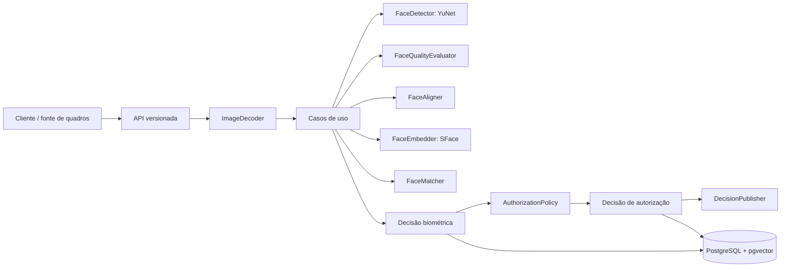

# Arquitetura

## Princípios

- O domínio conhece decisões e contratos, não frameworks.
- A biometria identifica; uma política separada autoriza.
- A entrada é uma imagem ou `FrameSource`, nunca uma câmera específica.
- A saída é resposta estruturada ou `DecisionPublisher`, nunca comando de hardware.
- Modelos e limiares são versionados e substituíveis.

## Camadas

- `domain`: entidades, enumerações, regras puras e protocolos.
- `application`: orquestração dos casos de uso.
- `adapters`: OpenCV, PostgreSQL, fontes de quadros e eventos.
- `api`: transporte HTTP e schemas públicos sem embeddings.
- `config`: configuração tipada por variáveis de ambiente.
- `observability`: logs estruturados; métricas e traces virão depois.

## Comparação 1:1 atual

Cada imagem é decodificada em memória, deve conter exatamente um rosto e passa pelos critérios de
qualidade. O rosto é alinhado pelos cinco landmarks do YuNet, transformado em embedding SFace,
normalizado e comparado por cosseno. O resultado é `identified` ou `unknown`; falhas anteriores
produzem decisões biométricas específicas.

## Cadastro e identificação 1:N

O cadastro consentido persiste pessoas, versões de modelo e múltiplos templates normalizados. Um
lote é transacional, e a revogação desativa todos os templates. A identificação consulta o
pgvector apenas na mesma versão de modelo, agrega o melhor template de cada pessoa e avalia o
melhor candidato, o segundo e a margem entre eles. O resultado continua sendo somente biométrico.

Política de autorização e registro persistente de eventos serão incrementos separados. O fluxo
temporal não altera o domínio biométrico.

## Captura local e confirmação temporal

No console de demonstração, o navegador funciona como `FrameSource`: a webcam permanece no
cliente e um quadro JPEG efêmero é enviado por vez ao endpoint de identificação local. Não existe
upload do fluxo de vídeo, fila de quadros ou gravação pela aplicação. Uma nova captura só começa
depois que a requisição anterior termina, evitando acumular imagens atrasadas.

O cliente mantém uma janela deslizante configurada pela API. A confirmação exige que o mesmo
`person_id` apareça em 3 de 5 resultados. O cronômetro começa somente quando algum rosto é
detectado e encaminha a tentativa para revisão após 5 segundos sem consenso. Essa orquestração é
estado efêmero da sessão do navegador; a identificação biométrica da API permanece independente e
sem estado entre quadros.

Para cadastro assistido, a mesma fonte captura cinco quadros guiados. Os `Blob`s permanecem apenas
na memória da página e são exibidos ao operador antes do envio ao endpoint de cadastro. O serviço
descarta amostras inválidas individualmente e persiste atomicamente as válidas quando há pelo menos
duas. Trocar a pessoa selecionada invalida a captura, e sair do fluxo ou descartar as amostras
revoga as URLs temporárias e libera a câmera.
